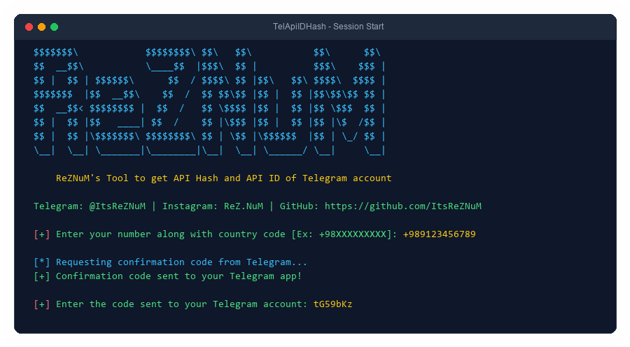
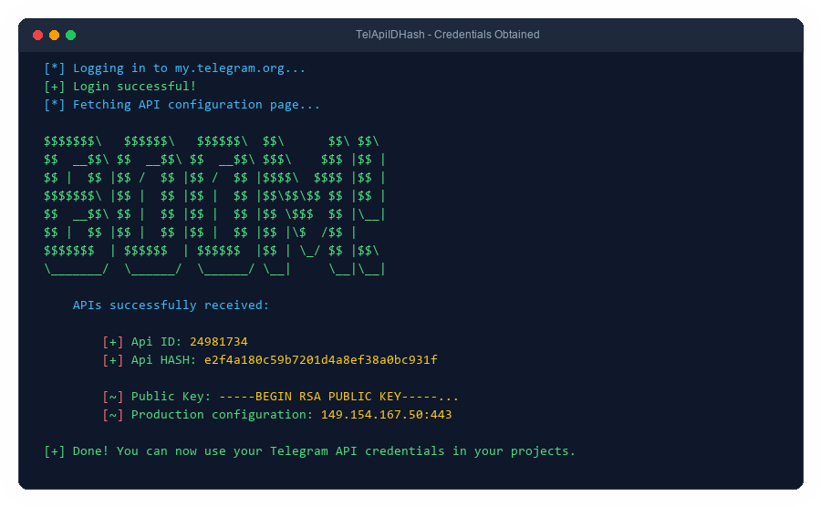
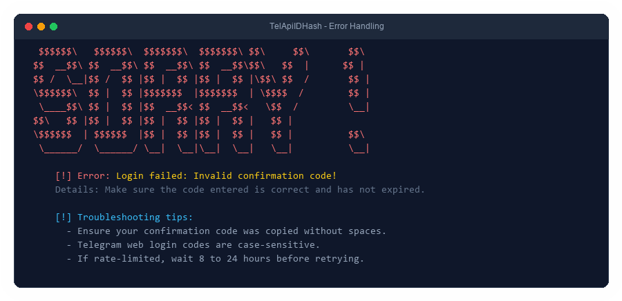

<p align="center">
  
</p>

# 📱 Telegram API Hash & ID Tool 🚀

A fast, resilient, and developer-friendly Python CLI tool to retrieve your **Telegram API ID** and **API Hash** directly from [my.telegram.org](https://my.telegram.org). Essential for developers creating Telegram bots, userbots, and clients with MTProto libraries like **Telethon**, **Pyrogram**, or **TDLib**! 🤖

---

## ✨ Key Features

- 🛡️ **Multi-Tier Resilient Scraping**: Extracts `api_id` and `api_hash` using flexible BeautifulSoup DOM traversal, selectable element detection, and regex fallbacks.
- ⚡ **Auto App Creation**: Detects when an account does not yet have a registered app and automatically creates one with safe defaults.
- 🌐 **Browser Simulation**: Emulates standard browser headers (`User-Agent`, `Referer`, `Origin`, `X-Requested-With`) to avoid silent blocks or Cloudflare drops.
- 🔍 **Detailed Error Reporting**: Identifies and explains rate limits (`Too many tries`), expired or invalid verification codes, and network failures with actionable advice.
- 🎨 **Terminal UI & Effects**: Retains ReZNuM's ASCII art banners and unscramble animations with full cross-platform `colorama` support.
- 📋 **Extended Data**: Extracts auxiliary parameters including Telegram **Public Keys** and **Production Configuration**.

---

## 🛠️ Requirements

- **Python**: 3.8 or higher
- **Dependencies**:
  - `beautifulsoup4`
  - `colorama`
  - `requests`

Install dependencies:

```bash
pip install -r requirements.txt
```

---

## 🚀 How to Use

1. **Clone the repository**:

   ```bash
   git clone https://github.com/ItsReZNuM/TelApiIDHash.git
   cd TelApiIDHash
   ```

2. **Install requirements**:

   ```bash
   pip install -r requirements.txt
   ```

3. **Run the script**:

   ```bash
   python main.py
   ```

4. **Follow the on-screen prompts**:
   - Enter your phone number with the international country code (e.g., `+98XXXXXXXXX` or `+1XXXXXXXXXX`).
   - Enter the confirmation code sent to your official Telegram app.
   - The tool will fetch (and if necessary, create) your Telegram developer application and display your credentials!

---

## 📸 Screenshots

### 1. Starting the Tool


### 2. Successful API Retrieval


### 3. Clear Error Handling


---

## 🔧 Troubleshooting & Known Issues

### 1. "It is not possible to get APIs for you!" (Resolved in v2.0)
- **Previous issue**: Earlier versions relied on brittle, exact label string matching (`App api_id:`) and failed when accounts had no existing application or when authentication failed silently.
- **Resolution**: `main.py` now uses multi-layered DOM and regex parsing, verifies authentication responses from Telegram, and handles accounts without applications automatically.

### 2. "Sorry, too many tries. Please try again later."
- Telegram rate-limits repeated login attempts or confirmation code requests.
- **Solution**: Wait **8 to 24 hours** before retrying. Avoid spamming requests or switching IP addresses rapidly.

### 3. "Login failed: Invalid confirmation code!"
- Telegram web login codes sent via Telegram service notifications are **case-sensitive** and alphanumeric (e.g., `tG59bKz`).
- **Solution**: Copy the code exactly as received without extra leading or trailing spaces.

### 4. Accounts with Two-Step Verification (2FA / Cloud Password)
- Note: `my.telegram.org` relies exclusively on the **Web Login Code** delivered to your Telegram app. It does not prompt for your MTProto 2FA cloud password. Always use the web code received in your Telegram chat notifications.

---

## 📬 Contact

Have questions, suggestions, or feedback? Feel free to reach out!

- **Telegram**: [@ItsReZNuM](https://t.me/ItsReZNuM) 📱
- **Instagram**: [ReZ.NuM](https://instagram.com/ReZ.NuM) 📷
- **GitHub**: [ItsReZNuM](https://github.com/ItsReZNuM) 🖥️

---

## 🤝 Contributing

Contributions are welcome! If you'd like to improve the tool:

1. Fork the repository 🍴
2. Create your feature branch (`git checkout -b feature/improvement`)
3. Commit your changes following [Conventional Commits](https://www.conventionalcommits.org/)
4. Push to the branch (`git push origin feature/improvement`)
5. Open a Pull Request 📬

---

## 📄 License

This project is open-source and available under the [MIT License](LICENSE).